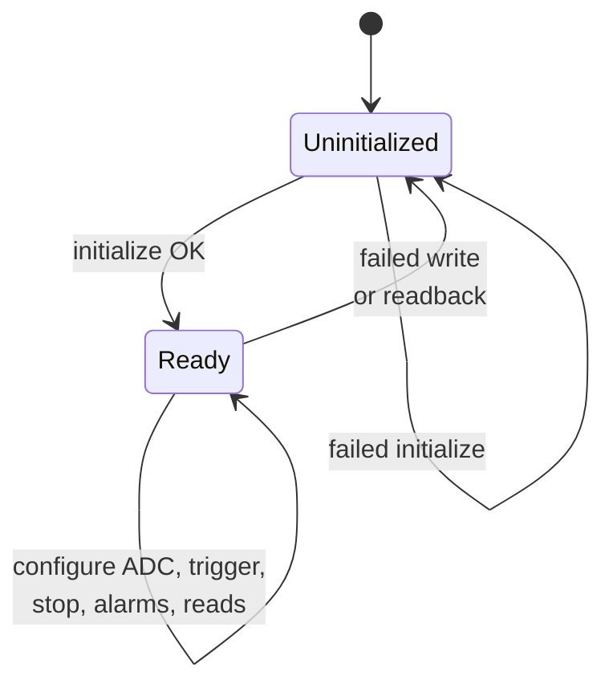
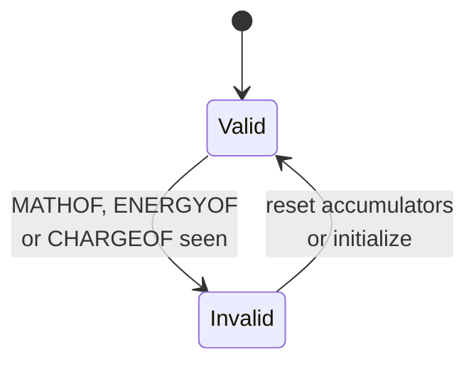
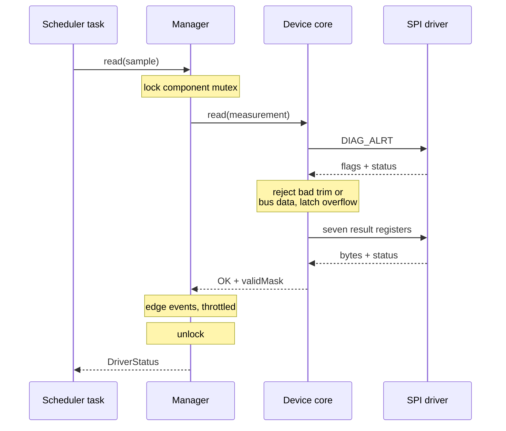

# Architecture and ownership

The application owns **when and why** to acquire. The manager owns one sensor's
F Prime interface and operational reporting. The device core owns INA229 behavior.
The platform driver owns **how** a bounded SPI transaction reaches hardware.

```text
Mission application / scheduler / fault policy
             | Configure and Read ports
      Ina229::Manager             commands, events, telemetry
             | owns
      Ina229::Device              register protocol and SI values
             | SpiBus::transfer + Delay::milliseconds
      manager port adapter        Drv.SpiWriteRead (status-returning)
             |
      platform SPI driver         controller, bus arbitration, chip select, deadline
             |
           INA229
```

The injected core can be used without F Prime:

```cpp
// NativeSpi implements Ina229::SpiBus; NativeDelay implements Ina229::Delay.
NativeSpi spi;
NativeDelay delay;
Ina229::Device sensor(spi, delay);
Ina229::Configuration config;
config.shuntOhms = 0.01;
config.maxCurrent = 8.0;
const auto status = sensor.initialize(config);
if (status == Ina229::Status::OK) {
    Ina229::Measurement sample;
    // Poll later when acquisition is due; NOT_READY is not a valid sample.
    if (sensor.read(sample) == Ina229::Status::OK) {
        consume(sample); // application-defined; check sample.validMask per channel
    }
}
```

In F Prime, the manager's adapter connects that same core to a generic byte-level
port, `Drv.SpiWriteRead`. The driver must report transfer failure through
`Drv.SpiStatus`; the deprecated void `Drv.SpiReadWrite` port cannot provide this
guarantee. A custom platform adapter may use a status-returning
HAL/OS API internally. Implement one component instance per chip-select or carry
bus/CS selection in the platform component configuration, outside INA229 registers.

No core function allocates memory. Scratch buffers are at most six bytes; acquisition
uses a fixed seven-element register array. No transport is called from construction.
The core retains references to its transport/delay providers, never to caller sample
or transfer buffers. A read commits its output only after all transfers succeed.

## Execution context

The manager is a passive component whose commands and input ports are all `guarded`:
each handler runs on the caller's thread while holding that instance's component mutex.

| Caller | Thread | Handlers |
| --- | --- | --- |
| Command dispatcher | Dispatcher task | `INITIALIZE`, `CONFIGURE_ADC`, `TRIGGER`, `STOP`, `RESET_ACCUMULATORS`, `SET_ALERT_CONFIG`, `SET_THRESHOLD`, `READ_SNAPSHOT`, `REPORT`, `CLEAR_EVENT_THROTTLE` |
| Application / scheduler | Its own task, typically a rate group | `configure`, `read` ports |

The mutex serializes these callers per sensor, so a command cannot interleave with a
read of the same device. Worst-case hold times, in SPI transactions of at most six bytes
each and excluding driver timeouts:

| Operation | Transfers | Other blocking |
| --- | --- | --- |
| `read` / `READ_SNAPSHOT` | 8 (DIAG_ALRT + seven results) | none |
| `INITIALIZE` / `configure` | 13 (two ID reads, reset, five verified writes) | 2 ms `Os::Task::delay` after reset |
| `RESET_ACCUMULATORS` | 4 (verified write, ENERGY and CHARGE drain) | none |
| `SET_ALERT_CONFIG` | 3 (read, verified write) | none |
| Other controls | 2 (verified write) | none |

A reader that arrives during `INITIALIZE` therefore waits up to about 2 ms plus 13
transfer times. Budget that in the scheduler deadline, or keep reinitialization out of
periods where that delay is unacceptable. Each transfer also blocks for the platform
driver's own timeout on failure. The component mutex does not arbitrate the SPI bus:
a shared physical driver must still serialize other clients and enforce its deadline.
Never invoke the manager from an interrupt handler.

The manager is single-level: it never calls its own guarded ports, so the non-recursive
component mutex cannot self-deadlock. `READ_SNAPSHOT` uses the same unlocked helper as
the `read` port.

## Lifecycle



`Ready` covers every ADC mode, including shutdown; `read()` rejects modes with no
selected channel. Accumulator validity is a separate latch inside `Ready`:



## Acquisition sequence



The library does not impose deployment rates, filtering, data products, current-trip
actions, reset/retry policy, or a power budget. Those policies differ between a bench
and flight software. A mission can connect the same manager to a native controller
while the [example](ft232h.md) uses a generic Unix-to-PyFtdi byte bridge.
